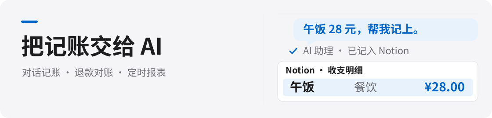
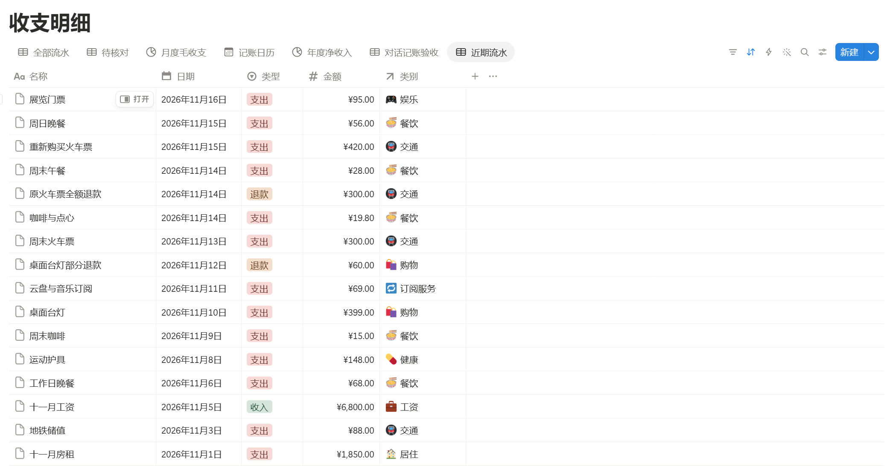
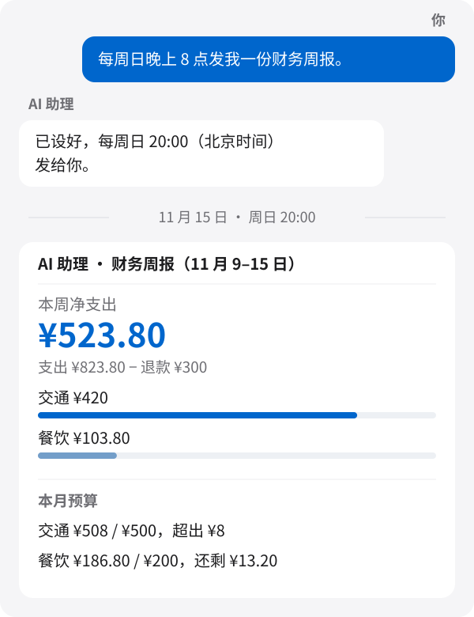

<p align="center">
  
</p>

<h1 align="center">AI × Notion 财务系统</h1>

<p align="center"><strong>开口就记账，打开 Notion 就能看。</strong></p>

<p align="center">
  <a href="https://github.com/deepseek-ai/deepseek-harness/blob/master/packages/mcp/mcp-manager/README.md"></a>
  <a href="https://docs.x.ai/grok-bot/computer-and-apps"></a>
  <a href="https://about.fb.com/news/2026/09/introducing-muse-small-business/"></a>
  <a href="https://help.openai.com/en/articles/20001530-getting-started-with-your-dot"></a>
  <a href="https://developers.notion.com/guides/mcp/get-started-with-mcp#claude-code"></a>
</p>

💬 对话记账 · 🧾 退款对账 · 📊 定时财务报表

「今天午饭 28，买了杯咖啡和点心，一共 19.80。昨天那张 300 元的火车票退回来了，帮我一起记上。」

像交代事情一样说就行。AI 助理帮你拆开每笔流水、归类、查找原单，记完再核对一遍。想知道钱花在哪儿，随时问它，也可以让它每周把财务报表发给你。你的账存在自己的 Notion 里，想看明细、改一笔或自己记，打开就行。

[在线演示](https://quashy.notion.site/Quashy-s-41a4aad76d8881e8987cd092b6c5163b) · [让 AI 帮我搭建](#让-ai-助理接手第一笔账) · [复制空白模板](https://quashy.notion.site/41a4aad76d888149a195fdfe4b231c1b)

[](https://quashy.notion.site/Quashy-s-41a4aad76d8881e8987cd092b6c5163b)

## 用你习惯的 Agent

其他能读写 Notion 的 Agent 也能接入。DeepSeek Harness 需已有可用的 Notion 连接，不默认提供开箱即用的 OAuth。日常记账需要 Notion 写权限；定时报表需要平台支持定时任务。

## 看 AI 助理怎么把账管起来

把接入指南交给 Personal Agent 就能开始：[复制下面这句开工指令](#让-ai-助理接手第一笔账)。能代办的让它做，确实缺连接、权限或信息时再问你，不用先自己搭服务、填钱包或设预算。

### 发一句话，记账、退款和核对一起做


<details>
<summary>查看文字版</summary>

> **你：** 帮我补一下周末的账：周六午饭 28 元、咖啡和点心 19.80 元，周日晚餐 56 元。周五那张 300 元的火车票周六全退到账了，周日我又买了一张 420 元的。
>
> **AI 助理：** 已记并核对 5 笔：3 笔餐饮合计 ¥103.80，1 笔新车票 ¥420，1 笔退款 ¥300。退款已关联到周五的原车票，原来的付款记录保留。
>
> **你：** 那这趟车票最后花了多少？
>
> **AI 助理：** 实际花了 **¥420**。原票 ¥300 已全退，只剩新票 ¥420，比原计划多花了 ¥120。

</details>

回到 Notion，可以逐笔看支出、退款，以及退款对应的原单。



### 不用等想起来问，到点就收到财务报表



<details>
<summary>查看文字版</summary>

> 每周日晚上 8 点发我一份本周财务小结：净支出多少、主要花在哪、这个月哪些预算快用完了。按北京时间。

> **本周财务小结**
>
> - **净支出 ¥523.80**：支出 ¥823.80，减去已到账退款 ¥300。
> - **主要花在交通和餐饮**：交通 ¥420，餐饮 ¥103.80。
> - **本月预算**：交通已超额，餐饮快用完了。

</details>

开好定时任务后，Personal Agent 每周按时读取 Notion 账本，把报表发给你。不用自己打开 Notion 筛日期，也可以改成每月发一次。

## 想自己看，打开 Notion 就行

### 看每个月结余的变化


### 看钱主要花在哪


### 看这个月还有多少能花


## 让 AI 助理接手第一笔账

把这句话发给你的 Personal Agent：

```text
请按这份指南帮我把 Notion 账本搭好：https://raw.githubusercontent.com/Quashy/notion-finance-ai/main/docs/AI_SETUP.md
```

[完整的 Agent 搭建指南](docs/AI_SETUP.md)

想手动使用 Notion？也可以[复制模板](https://quashy.notion.site/41a4aad76d888149a195fdfe4b231c1b)，从首页点「新增支出」或「新增收入」。

### 开始前

账本目前以人民币记账。AI 根据你提供的交易信息和你授权访问的 Notion 记录办事；银行卡、支付宝和微信账单不会自动导入。
