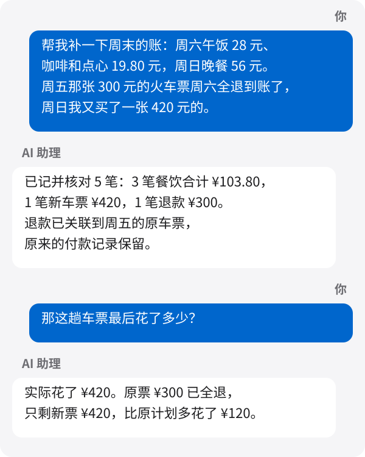
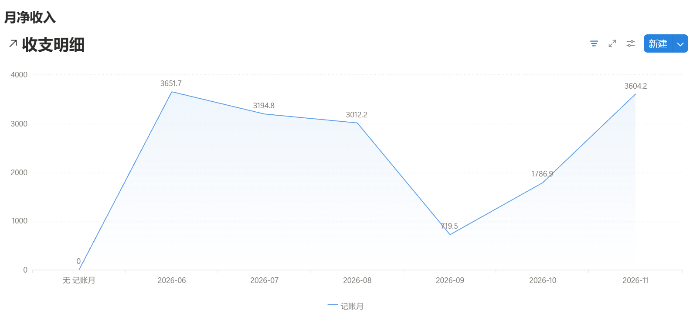
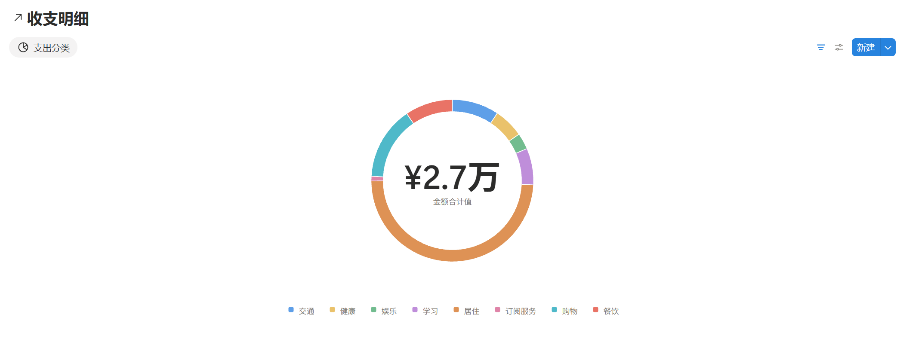

<p align="center">
  
</p>

<h1 align="center">AI × Notion 财务系统</h1>

<p align="center"><strong>开口就记账，打开 Notion 就能看。</strong></p>

<p align="center">
  <a href="https://github.com/deepseek-ai/deepseek-harness/blob/master/packages/mcp/mcp-manager/README.md"></a>
  <a href="https://docs.x.ai/grok-bot/computer-and-apps"></a>
  <a href="https://about.fb.com/news/2026/09/introducing-muse-small-business/"></a>
  <a href="https://help.openai.com/en/articles/20001530-getting-started-with-your-dot"></a>
  <a href="https://developers.notion.com/guides/mcp/get-started-with-mcp#claude-code"></a>
</p>

<p align="center">AI 助理帮你记账、核对退款、定时发报表。账留在你自己的 Notion，随时能查。</p>

<p align="center">
  <a href="https://quashy.notion.site/Quashy-s-41a4aad76d8881e8987cd092b6c5163b"><strong>在线演示</strong></a> · <a href="#quick-start"><strong>让 AI 帮我搭建</strong></a>
</p>

## 💬 看 AI 怎么管账

### 退票重买，最后花了多少？



<details>
<summary>查看文字版</summary>

> **你：** 帮我补一下周末的账：周六午饭 28 元、咖啡和点心 19.80 元，周日晚餐 56 元。周五那张 300 元的火车票周六全退到账了，周日我又买了一张 420 元的。
>
> **AI 助理：** 已记并核对 5 笔：3 笔餐饮合计 ¥103.80，1 笔新车票 ¥420，1 笔退款 ¥300。退款已关联到周五的原车票，原来的付款记录保留。
>
> **你：** 那这趟车票最后花了多少？
>
> **AI 助理：** 实际花了 **¥420**。原票 ¥300 已全退，只剩新票 ¥420，比原计划多花了 ¥120。

</details>

### 设一次，每周自动收到财务周报


<details>
<summary>查看文字版</summary>

> **你：** 每周日晚上 8 点发我一份财务周报。
>
> **AI 助理：** 已设好，每周日 20:00（北京时间）发给你。

**11 月 15 日 · 周日 20:00**

> **AI 助理 · 财务周报（11 月 9–15 日）**
>
> **本周净支出 ¥523.80**
>
> 支出 ¥823.80 − 退款 ¥300
>
> - 交通 ¥420
> - 餐饮 ¥103.80
>
> **本月预算**
>
> - 交通 ¥508 / ¥500，超出 ¥8
> - 餐饮 ¥186.80 / ¥200，还剩 ¥13.20

</details>

支持定时任务的 Agent 可以按周或按月发送。

<a name="quick-start"></a>

## 🚀 一句话开始

把这句话发给你的 Personal Agent：

```text
请按这份指南帮我把 Notion 账本搭好：https://raw.githubusercontent.com/Quashy/notion-finance-ai/main/docs/AI_SETUP.md
```

Agent 会帮你连接 Notion、接入已有账本或复制模板并完成配置，需要你登录、授权或配合时再问你。搭好后，会简单介绍怎么记账和查账。

[完整的 Agent 搭建指南](docs/AI_SETUP.md)

想手动记账？[复制空白模板](https://quashy.notion.site/41a4aad76d888149a195fdfe4b231c1b)，从首页点「新增支出」或「新增收入」。

## 📊 打开 Notion 看账

[](https://quashy.notion.site/Quashy-s-41a4aad76d8881e8987cd092b6c5163b)

<details>
<summary>看流水怎么记</summary>


</details>

<details>
<summary>看图表和预算</summary>

### 每个月结余的变化



### 钱主要花在哪



### 这个月还有多少能花


</details>

### 开始前

账本目前以人民币记账。AI 根据你提供的交易信息和你授权访问的 Notion 记录办事；银行卡、支付宝和微信账单不会自动导入。
