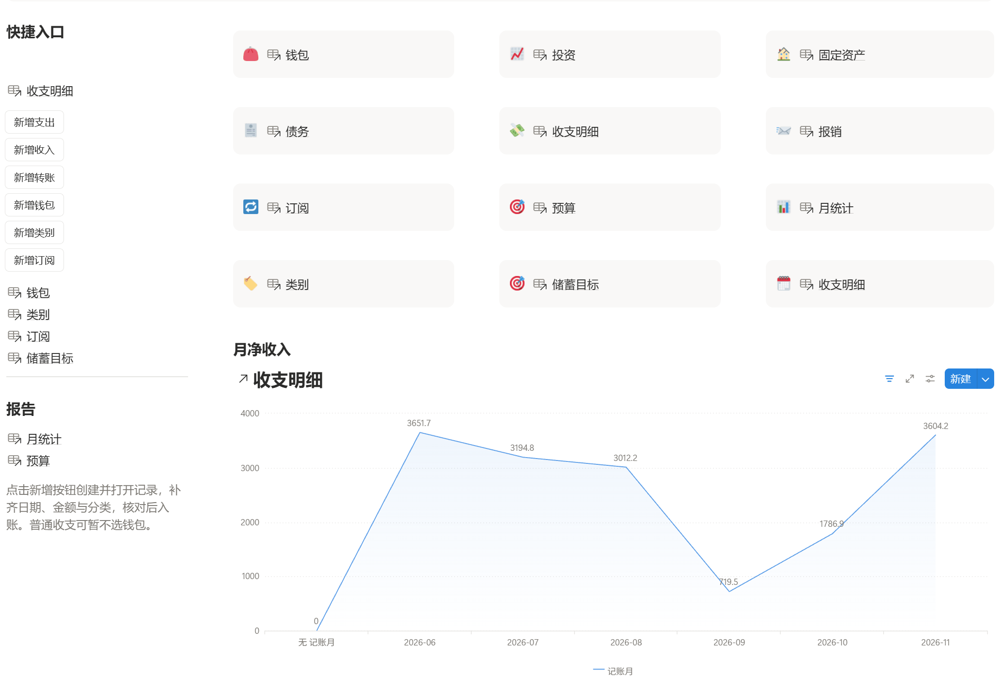
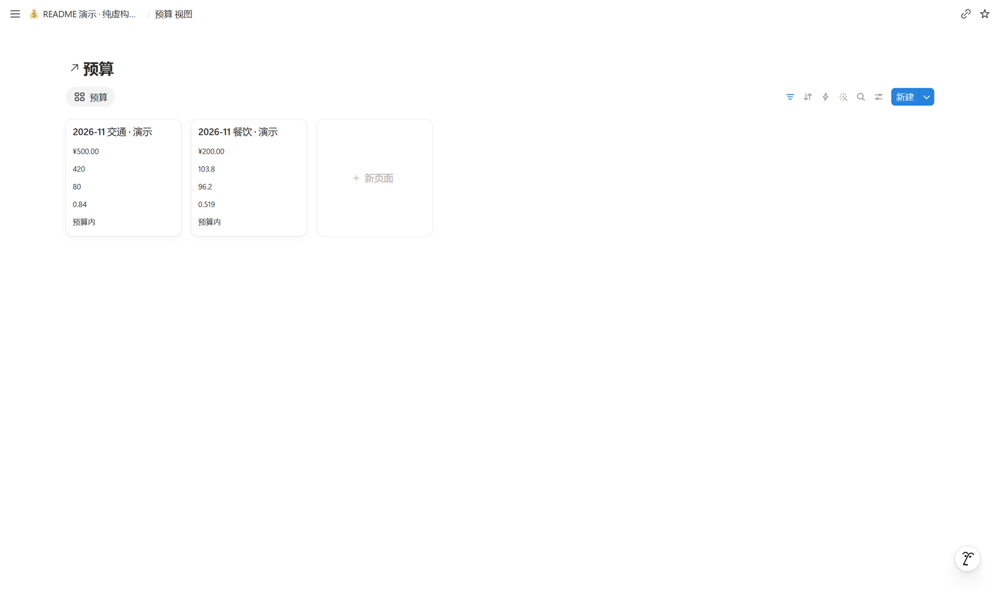

# AI × Notion 财务系统

### 把记账这件事，交给 AI 助理

「今天午饭 28，买了杯咖啡和点心，一共 19.80。昨天那张 300 元的火车票退回来了，帮我一起记上。」

像交代事情一样说就行。AI 助理帮你拆开每笔流水、归类、查找原单，记完再核对一遍。想知道钱花在哪儿，随时问它，也可以让它每周把财务报表发给你。你的账存在自己的 Notion 里，想看明细、改一笔或自己记，打开就行。

[让 AI 帮我搭建](#让-ai-助理接手第一笔账) · [看看它怎么管账](#看-ai-助理怎么把账管起来) · [复制 Notion 模板](https://quashy.notion.site/306-Money-41a4aad76d888149a195fdfe4b231c1b)

## 看 AI 助理怎么把账管起来

先把 [Notion 模板](https://quashy.notion.site/306-Money-41a4aad76d888149a195fdfe4b231c1b)复制到自己的工作区，再把**你的账本首页链接**和[接入指南](docs/AI_SETUP.md)发给 Personal Agent。只要它能连接 Notion，并且能读取和写入这份账本，就可以开始记。不用自己搭服务，也不用先填好钱包和预算。

### 发一句话，记账、退款和核对一起做

> **你：** 帮我补一下周末的账：周六午饭 28 元、咖啡和点心 19.80 元，周日晚餐 56 元。周五那张 300 元的火车票周六全退到账了，周日我又买了一张 420 元的。
>
> **AI 助理：** 已记并核对 5 笔：3 笔餐饮合计 ¥103.80，1 笔新车票 ¥420，1 笔退款 ¥300。退款已关联到周五的原车票，原来的付款记录保留。
>
> **你：** 那这趟车票最后花了多少？
>
> **AI 助理：** 实际花了 **¥420**。原票 ¥300 已全退，只剩新票 ¥420，比原计划多花了 ¥120。

回到 Notion，可以逐笔看支出、退款，以及退款对应的原单。


### 不用等想起来问，到点就收到财务报表

> 每周日晚上 8 点发我一份本周财务小结：净支出多少、主要花在哪、这个月哪些预算快用完了。按北京时间。

开好定时任务后，Personal Agent 每周按时读取 Notion 账本，把报表发给你。不用自己打开 Notion 筛日期，也可以改成每月发一次。

> **本周财务小结**
>
> - **净支出 ¥523.80**：支出 ¥823.80，减去已到账退款 ¥300。
> - **主要花在交通和餐饮**：交通 ¥420，餐饮 ¥103.80。
> - **本月预算**：交通已超额，餐饮快用完了。

记账和查账用 Notion 连接就够了；要定时收报表，你用的 Agent 还得支持定时任务。

## 想自己看，打开 Notion 就行

### 首页总览



### 看每个月结余的变化


### 看钱主要花在哪


### 看这个月还有多少能花



## 让 AI 助理接手第一笔账

1. [复制 Notion 模板](https://quashy.notion.site/306-Money-41a4aad76d888149a195fdfe4b231c1b)到自己的工作区。
2. 把你的账本首页链接和下面这句话发给能连接 Notion 的 Personal Agent，按提示给它这份账本的读写权限。
3. 发出第一笔日常支出，打开 AI 返回的记录，看看日期、金额和分类是否正确。

```text
请阅读下面的指南，连接我自己的 Notion 财务账本，带我记下第一笔支出：
https://raw.githubusercontent.com/Quashy/notion-finance-ai/main/docs/AI_SETUP.md
```

[完整的 Agent 搭建指南](docs/AI_SETUP.md) · 想直接用 Notion？复制后从首页点「新增支出」或「新增收入」。

### 开始前

账本目前以人民币记账。AI 根据你提供的交易信息和你授权访问的 Notion 记录办事；银行卡、支付宝和微信账单不会自动导入。
